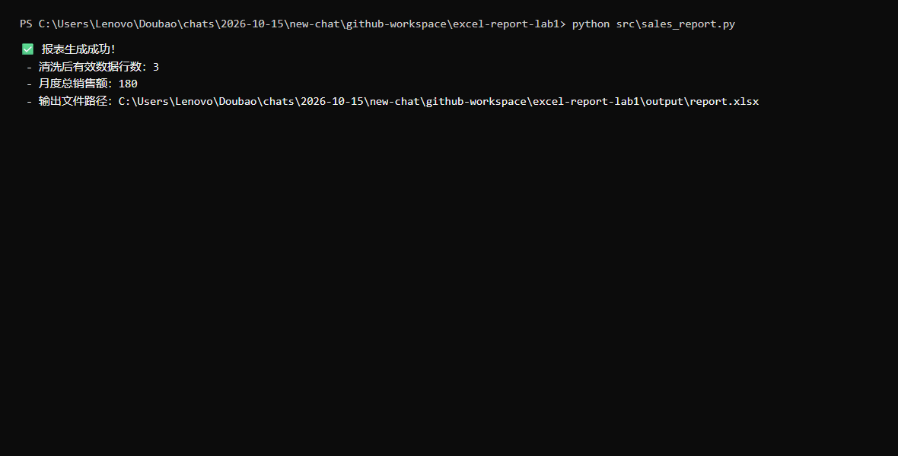
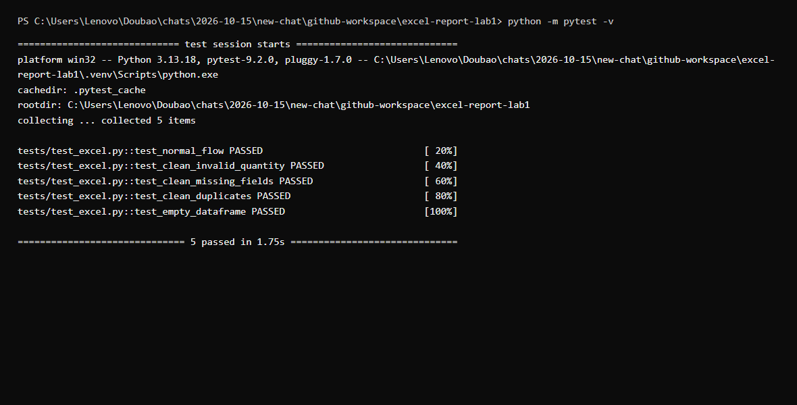

# 实验报告：Lab1 考题一 · Excel 销售报表生成脚本

| 项目 | 内容 |
| --- | --- |
| 课程 | Python 程序设计 |
| 实验名称 | Lab1 考题一：Excel 销售报表生成脚本（Python Vibe Coding 实验一） |
| 姓名 / 学号 | ________ / ________ |
| 完成日期 | 2026-11-18 |
| 仓库地址 | https://github.com/qls-eng/excel-report-lab1 |

## 一、实验目的

1. 掌握 pandas 读取 / 写入 Excel（`read_excel` + `ExcelWriter`）的基本流程。
2. 掌握数据清洗三部曲：缺失值处理、异常值剔除、重复行去除。
3. 掌握 `groupby` 分组汇总与派生列计算（销售额 = 数量 × 单价）。
4. 建立"原始数据只读、所有结果另存"的数据处理习惯，避免覆盖源文件。
5. 让脚本在异常输入下给出可读的中文提示而不是抛出堆栈。

## 二、需求与验收标准

题目只给了一段需求描述，先做需求澄清（详见 `docs/需求澄清_考题一.md`）：

| 项 | 结论 |
| --- | --- |
| 输入 | `data/sales_raw.xlsx`，字段：日期、销售员、产品、数量、单价、地区 |
| 清洗规则 | 关键字段缺失行删除；数量 ≤ 0 剔除；按全字段去重 |
| 统计规则 | 销售额 = 数量 × 单价；按销售员、按地区汇总；月度总额 |
| 输出 | `output/report.xlsx`，四个工作表：明细清洗后 / 按销售员 / 按地区 / 总览 |
| 约束 | 原始文件只读，不回写 `data/` |
| 验收 | 一键运行生成报表；四表齐全；数值可与手算核对；异常输入不崩溃 |

> 说明：老师未提供 `sales_raw.xlsx`，本仓库自行构造了一份含**负数量、数量为 0、重复行**的样例数据，用于验证清洗逻辑。

## 三、技术选型与环境

| 项 | 选择 |
| --- | --- |
| 数据处理 | pandas（`read_excel` / `groupby` / `ExcelWriter`） |
| Excel 读写引擎 | openpyxl |
| 测试 | pytest |
| 运行环境 | Windows 11 + Python 3.13.18（项目内 `.venv`），pandas + openpyxl + pytest 已锁入 `requirements.txt` |

## 四、实现要点

### 4.1 清洗函数 `clean_sales`

```python
# 数量、单价强制转数值，无法转换的脏数据变为 NaN
df_clean['数量'] = pd.to_numeric(df_clean['数量'], errors='coerce')
df_clean['单价'] = pd.to_numeric(df_clean['单价'], errors='coerce')

df_clean = df_clean.dropna(subset=required_cols)   # 关键字段缺失行删除
df_clean = df_clean[df_clean['数量'] > 0]          # 数量 <= 0 剔除
df_clean = df_clean.drop_duplicates()              # 全字段去重
df_clean = df_clean.reset_index(drop=True)
```

`errors='coerce'` 的作用是把"abc"这类无法转成数字的脏值变成 `NaN`，随后被 `dropna` 一并清掉，避免 `astype(float)` 直接抛异常。

### 4.2 汇总函数 `build_stats`

```python
df_stats['销售额'] = df_stats['数量'] * df_stats['单价']
by_sales = df_stats.groupby('销售员', as_index=False)['销售额'].sum()
by_region = df_stats.groupby('地区', as_index=False)['销售额'].sum()
total = pd.DataFrame({'月度总额': [df_stats['销售额'].sum()]})
```

两个汇总都按销售额降序排列，便于直接看出主力销售员 / 主力地区。

### 4.3 主流程的七道检查

`main()` 里依次是：文件是否存在 → 能否读取（损坏 / 格式错） → 是否为空 → 关键字段是否齐全 → 清洗 → 清洗后是否还有数据 → 写入 `output/`。每一步失败都打印中文原因并 `sys.exit(1)`（清洗后无数据则 `exit(0)`，属于正常结果而非错误）。

### 4.4 输出目录自动创建

```python
os.makedirs(os.path.dirname(output_path), exist_ok=True)
```

避免"输出目录不存在导致写文件失败"这种环境差异问题。

## 五、运行结果

在项目根目录执行 `python src\sales_report.py`，真实输出如下：



原始数据与清洗结果对照（手工核对）：

| 原始行 | 日期 | 销售员 | 产品 | 数量 | 单价 | 地区 | 处理 |
| --- | --- | --- | --- | --- | --- | --- | --- |
| 1 | 2024-01-01 | 张三 | A | 2 | 10 | 华东 | 保留 |
| 2 | 2024-01-02 | 李四 | B | 3 | 20 | 华北 | 保留 |
| 3 | 2024-01-03 | 张三 | A | −1 | 10 | 华东 | 剔除（数量 ≤ 0） |
| 4 | 2024-01-04 | 王五 | C | 0 | 5 | 华南 | 剔除（数量 ≤ 0） |
| 5 | 2024-01-05 | 李四 | B | 5 | 20 | 华北 | 保留 |
| 6 | 2024-01-05 | 李四 | B | 5 | 20 | 华北 | 剔除（重复行） |

原始 6 行 → 清洗后 3 行，脚本打印"清洗后有效数据行数：3"，与手数一致。

生成的 `output/report.xlsx` 四个工作表内容：

| 工作表 | 内容 |
| --- | --- |
| 明细清洗后 | 3 行有效明细（张三 2024-01-01 / 李四 2024-01-02 / 李四 2024-01-05） |
| 按销售员 | 李四 160、张三 20（降序） |
| 按地区 | 华北 160、华东 20（降序） |
| 总览 | 月度总额 180 |

**数值核对**

- 张三：2 × 10 = 20
- 李四：3 × 20 + 5 × 20 = 60 + 100 = 160
- 月度总额：20 + 160 = 180 ✓（与脚本打印的 180 一致）
- 地区口径：华东仅张三 20，华北仅李四 160，两地区之和 = 180，与月度总额一致 ✓

## 六、自动化测试

执行 `python -m pytest -v`，5 个用例全部通过：



| 用例 | 覆盖点 |
| --- | --- |
| `test_normal_flow` | 正常流程：清洗后行数、四表生成、汇总数值 |
| `test_clean_invalid_quantity` | 数量为负数 / 0 的行被剔除 |
| `test_clean_missing_fields` | 关键字段缺失的行被删除 |
| `test_clean_duplicates` | 完全重复的行只保留一条 |
| `test_empty_dataframe` | 传入空 DataFrame 时返回结构正确、不报错 |

早期在 PyCharm 中运行同一套用例的截图（Python 3.6.5 环境）见 `docs/images/test_excel_result.png`，可用于对照不同环境下结果一致。

## 七、问题与解决

| 问题 | 现象 | 处理 |
| --- | --- | --- |
| 脏值导致类型错误 | 直接用 `astype(float)` 碰到非数字文本会抛 `ValueError` | 改用 `pd.to_numeric(..., errors='coerce')`，脏值转 NaN 后统一剔除 |
| 输出目录不存在 | 首次运行时 `output/` 不存在导致写文件失败 | `os.makedirs(..., exist_ok=True)` 自动创建 |
| 空清洗结果的判断 | 清洗后没有有效行时若继续写，会生成空表 | 先判断 `df_clean.empty`，打印提示后正常退出，不生成空报表 |
| 覆盖源文件风险 | 输出路径误写成 `data/` 会破坏原始数据 | 输出固定为 `output/report.xlsx`，与输入目录分离 |

## 八、小结

- 清洗逻辑集中在 `clean_sales` 一个函数里，规则改动只改一处，测试也围绕它写，符合"逻辑与 IO 分离"。
- 先澄清需求（尤其是脏数据类型和输出表结构）再写码，避免了"写完发现表结构不对"的返工。
- 样例数据要**故意做脏**才有验证价值：本次 6 行里有 3 行是负数量、零数量、重复行，正好覆盖三条清洗规则。

## 九、交付清单

| 交付物 | 位置 |
| --- | --- |
| 源码 | `src/sales_report.py` |
| 测试 | `tests/test_excel.py`（5 个用例） |
| 样例数据 | `data/sales_raw.xlsx`（只读） |
| 生成报表 | `output/report.xlsx`（四个工作表） |
| 运行截图 | `docs/images/run_output.png` |
| 测试截图 | `docs/images/pytest_output.png`、`docs/images/test_excel_result.png` |
| 过程文档 | `docs/需求澄清_考题一.md`、`docs/ai对话记录.md`、`docs/复盘.md` |
